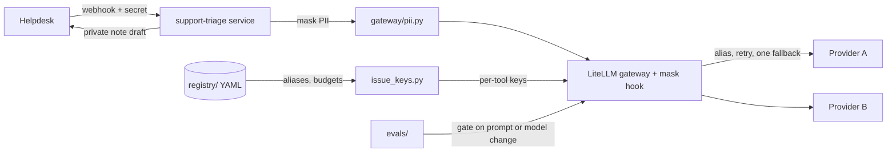

# internal-ai-platform

[](https://github.com/chasanc/internal-ai-platform/actions/workflows/ci.yml)

A small reference implementation of an internal AI platform: how to choose a model, prove a change is safe, and keep tools governed. Everything is synthetic and fictional.

**The problem:** teams adopt AI tools quickly, and nobody can say which model to use, whether a prompt or model change made things worse, or which tools touch sensitive data. This repo answers those three questions with working code instead of slides.

**Headline result:** on 50 synthetic support tickets, the cheapest model (Claude Haiku) matched the larger models on category at about 5% of Sonnet's cost per ticket. The numbers, intervals and caveats are below and in ADR 0001.

## What is here

- **`evals/`**: field-level evaluation with confidence intervals, a paired regression test and a CI gate. See ADR 0001 for a four-model comparison and ADR 0004 for why not an LLM judge.
- **`services/support-triage/`**: a webhook service that drafts private notes, with a kill switch, shadow mode, idempotency and one fallback path.
- **`gateway/`**: LiteLLM config with aliases and one fallback, plus a PII and financial-id masker that also runs inside the gateway on every request.
- **`registry/`**: tool registry in YAML. Tier is derived from data class and human review; CI enforces it.
- **`tools/`**: six small tools (engineering, two for marketing, finance, people, supply), each with a prompt, a contract and a golden set. `competitor-digest` summarises crawled public page text; the crawl and the delivery stay outside this repo.
- **`examples/`** and [`docs/using-the-gateway.md`](docs/using-the-gateway.md): a client in Python, TypeScript, Go and C# and example calls for each department, with the rules every caller follows.
- **`docs/`**: architecture and decision records, and [`docs/load-balancing.md`](docs/load-balancing.md) for running several instances (`make up-ha smoke-ha`).



More detail on each part is in [`docs/architecture.md`](docs/architecture.md).

## Results

Four models on the same 50 synthetic support tickets, prompt v3 (the current service prompt), one run each (raw files in `evals/results/v3-*.json`; the earlier v2 runs are in `evals/results/v2-*.json`; reasoning and caveats in ADR 0001):

| model | category | priority | needs_human | schema | p95 latency | $/ticket |
|---|---|---|---|---|---|---|
| claude-haiku-5-5 | 0.98 | 0.90 | 0.90 | 1.00 | 2.1 s | 0.000156 |
| claude-sonnet-5-5 | 0.96 | 0.84 | 0.86 | 0.96 | 3.4 s | 0.002976 |
| gpt-5.4-mini-2026-03-17 | 0.92 | 0.84 | 0.84 | 1.00 | 1.2 s | 0.000671 |
| gpt-5.5-2026-04-23 | 0.96 | 0.86 | 0.92 | 1.00 | 3.5 s | 0.006159 |

At n = 50 a 2-point gap is one ticket, so differences of a few points are within noise. v3 against v2: no model changed significantly on category (paired test, all p = 1.0). The cheapest model that passes the gate (haiku) is the baseline. Latency is from one run, so treat it as rough. On the 12-case account set (haiku only) category, priority and needs_human were each 0.83, one reply failed the schema, and no draft repeated an account value (0 of 12); that set is small and not gated.

## Run it

```
uv sync
make test                 # no real model calls: tests block them
make gate                 # compare candidate to baseline
make up smoke             # local stack, mock model, no provider keys
```

To change the demo webhook secret, set `WEBHOOK_SECRET` in your shell or in `.env` (`openssl rand -hex 32`); the stack and `make smoke` both read it.

Real model calls are off by default. `make eval`, `make up-real` and `make smoke-real` spend money and need keys in `.env`; the last two also need `CONFIRM_REAL_AI=yes`.

## Honest limits

- Evals are 50 tickets, one run per model. Priority results were tuned on the same labels as the rubric. A 20-ticket held-out run (haiku only) scored priority 0.90, interval 0.70 to 0.97, which is encouraging but small, and the same author labelled it.
- The department golden sets (16 items each) have only been run against a stub that returns the answer, so they prove the pipeline, not model quality.
- The PII and financial-id masker is regex only (emails, cards, phones, addresses, IBANs, keyword-led account numbers, tax ids). Names, free-form addresses and bare account numbers pass through, and replies are not masked. The gateway applies it to every request as a second layer; that hook is unit-tested and loads in the mock stack, but the mock model ignores its input, so it has not been seen end to end with a real model.
- Idempotency is in memory by default (a retried delivery is caught while the first is in flight, but a restart forgets everything); `IDEMPOTENCY_DB` switches to a SQLite file that survives restarts and is shared by workers on one machine, and `IDEMPOTENCY_DB_URL` to Postgres for several instances (tested against a fake connection and in the local two-instance stack, not a managed database). The default helpdesk is a fake; a REST adapter (`HELPDESK_URL`) and an optional Postgres account lookup (`CUSTOMER_DB_URL`) exist but were only tested against fakes, never a live helpdesk or database.
- The service prompt is v3 (it adds an optional account line). v3 was run once per model on the golden set, plus haiku on the 12-case account set (`evals/datasets/support-triage.account.jsonl`, not gated) and the 20-ticket held-out set. The baseline and `candidate.json` are the haiku v3 result. These runs call the models directly; the gateway, the account lookup and the full service path were not exercised with a real model.
- Telemetry is logs plus a report script (`scripts/telemetry_report.py`: action rates, fallback rate, latency, cost per tool). There are no dashboards or alerting; the cost input format is assumed, not checked against a live gateway.
- The webhook checks a shared secret (`WEBHOOK_SECRET`), not a body signature, and has no replay window. If the variable is unset the service refuses to start (`ALLOW_INSECURE_LOCAL=1` is the local-only opt-out). The demo compose stack sets a dev-only default and `make smoke` checks that a request without the secret gets 401. Put it behind a private network or gateway in real use.
- Input is bounded (20,000 characters of ticket text) and the schema is strict, but there is no rate limit.
- CI runs the tests and the gate with mock models only; no provider keys are configured on GitHub. Real-model runs (`make eval`, `make up-real smoke-real`) are local and manual. The mock Docker stack has been run end to end, and the real path was run once (2026-11-27, `make up-real smoke-real`): one ticket in shadow mode through the service and gateway to a real model, outcome `shadow`, about 1.4 s. That ticket had no personal data, so the gateway masking hook was not seen working with a real model, and the account lookup and helpdesk adapter were not in that run.
- Registry owners (`@example.com`) and CODEOWNERS teams are placeholders for a fictional organisation.
