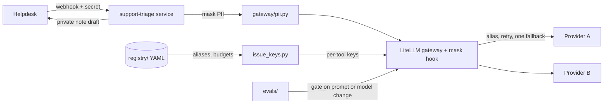

# Architecture

## Parts

| Part | What it does |
|---|---|
| `services/support-triage/` | Webhook in, masked text (plus an optional account line looked up by sender email) to the gateway, validated result out as a private note. One fallback path (ADR 0005). |
| `gateway/` | LiteLLM config (aliases, fallback, no message logging) and the PII and financial-id masker, which also runs in the gateway on every request (ADR 0002). |
| `registry/` | One YAML per tool; tier is derived from data class and review. CI checks it (ADR 0003). |
| `evals/` | Field-level scoring with Wilson intervals and a paired test; the gate blocks regressions (ADR 0004). `evals/tools.py` scores the department tools. |
| `tools/` | Small department tools (engineering, marketing, finance, people, supply): prompt, contract, golden set. |
| `templates/python-service/` | Starting point for a new service. |

## Request flow

1. The helpdesk posts a ticket to `/webhook`.
2. The service checks the kill switch and idempotency, then masks PII.
3. It calls the gateway with an alias, not a model name.
4. The reply is parsed against the strict contract. Anything invalid goes down the fallback path and nothing is written.
5. In shadow mode the draft is dropped; otherwise it is posted as a private note.

## Change flow

A prompt, model or dataset change needs a fresh `evals/results/candidate.json` in the PR. The gate fails if a schema or category floor is missed, or if the candidate is significantly worse than the baseline.
